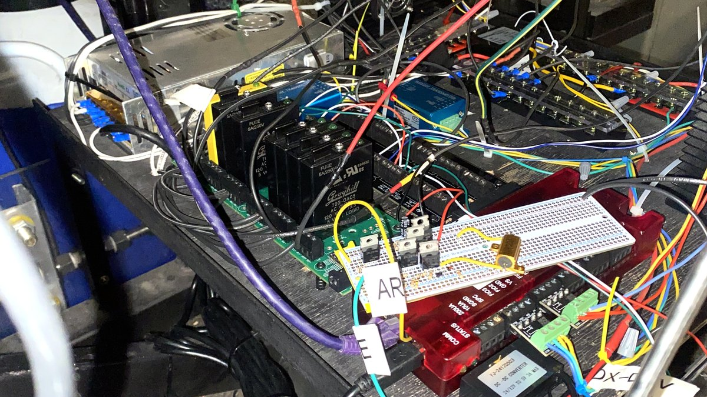
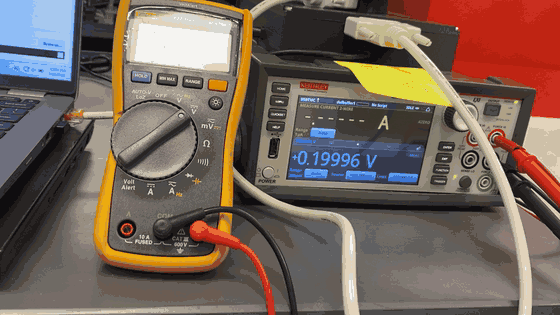
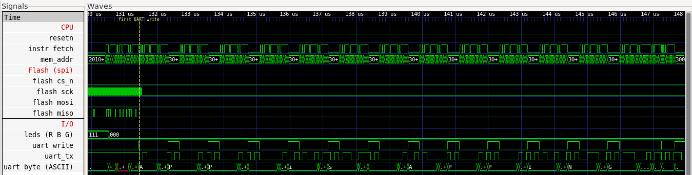

# MasterUser43 | Electrical Engineering @ ASU

*Firmware, FPGAs & test automation for rockets and solar cells.*

Working on rev3 and the liquids DAQ at [**Sun Devil Rocketry**](https://github.com/SunDevilRocketry) and building measurement tools for perovskite solar cells at the [**Rolston Lab**](https://rolston.lab.asu.edu/), with memristor work next.

---

### Projects

<table>
<tr>
<td width="50%" valign="top">

 <b><a href="https://github.com/SunDevilRocketry/LQD-DAQ">LQD-DAQ</a></b> (Sun Devil Rocketry)
 Ground DAQ and sequencing service for the liquid engine feed system.
   
</td>
<td width="50%" valign="top">

 <b><a href="https://github.com/rolston-lab-asu/PixelMux">Pixel Mux</a></b> (Rolston Lab)
 Automated measurements for perovskite solar cells.
   
</td>
</tr>
</table>

<table>
<tr>
<td valign="top">

 <b><a href="https://github.com/SunDevilRocketry/FPGABoard">FPGABoard</a></b> (Sun Devil Rocketry)
 iCE40 softcore-processor for the flight computer.
   
</td>
</tr>
</table>

---

### Tech stack

**Embedded:** `STM32 (H7/F4)` `DMA` `SPI` `I2C` `UART` `USB-CDC` `libusb`\
**FPGA:** `iCE40UP5K` `PicoRV32` `Apio (Yosys, nextpnr)` `Icarus Verilog` `GTKWave`\
**Scientific:** `PyVISA` `NumPy/SciPy` `PySide6` `pyqtgraph`
